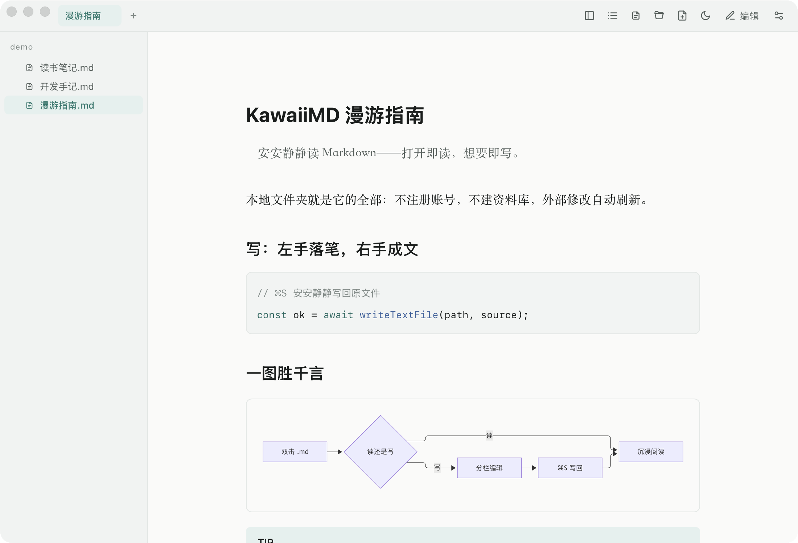
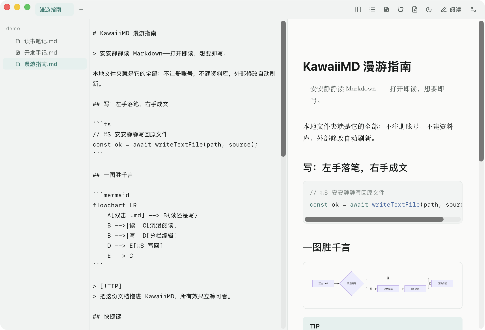
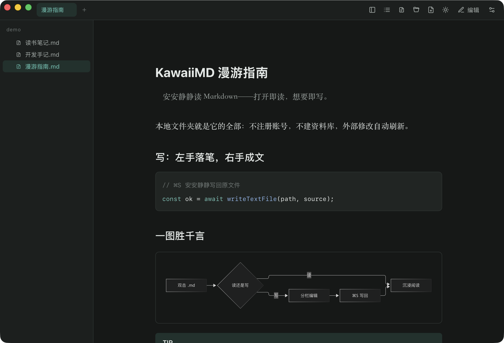

# KawaiiMD

**[简体中文](README.zh-CN.md)** · English

A simple, fast, and lightweight Markdown reader & editor for macOS. Free & open-source alternative to Typora.

<p align="center">
  
</p>
<p align="center">
  &nbsp;&nbsp;
  
</p>

## Why KawaiiMD

- **Free & open source.** No license key, no activation, no countdown — everything Typora charges for, in the open.
- **Genuinely lightweight.** A Rust shell over the system WebView, no bundled Chromium. The whole installer is ~4 MB, and it launches in a blink.
- **Local-first.** Your folders *are* the library: no account, no database, no import step, no lock-in. Files stay plain `.md` on disk.
- **Reader-grade typography.** Serif body text tuned for Chinese, an ink-teal palette, light/dark themes that Mermaid diagrams and code highlighting follow automatically.
- **Writing that keeps up.** Split-pane editing with live preview, scroll-synced by heading anchors, CodeMirror 6 inside, auto-save on ⌘S and window close.
- **Stays out of your way.** Multi-tab with session restore, auto-reload when files change outside (scroll position preserved, conflicts ask before overwriting), macOS-native overlay title bar and scrollbars.

## Features

- Open via double-click, drag & drop, or the sidebar tree — `.md` `.markdown` `.mkd` `.mdx`, full GFM (tables, task lists, alert callouts)
- Mermaid diagrams — theme-aware, skeleton placeholder while loading, graceful fallback on error
- Syntax-highlighted code blocks with one-click copy
- Folder tree with lazy loading + Markdown-only filter, table-of-contents panel
- External-change watcher: reloads in ≤ 0.5 s, keeps your scroll, asks on conflict
- Multi-tab (⌘T / ⌘W / ⌘1-9), Finder-style in-tree new file (⌘N), session restore
- Light/dark themes (⇧⌘T), CJK serif reading column

Want a quick tour? Open the `demo/` folder — `漫游指南.md` walks through everything.

## Install

**From source** (a prebuilt DMG will land in Releases soon):

```bash
pnpm install
pnpm tauri build   # produces src-tauri/target/release/bundle/dmg/*.dmg
```

Requires Node ≥ 20, pnpm, Rust stable, and Xcode Command Line Tools. The DMG is ad-hoc signed — right-click → Open on first launch if Gatekeeper complains.

## Development

```bash
pnpm tauri dev     # run the app in dev mode
pnpm vitest run    # frontend unit tests
pnpm check         # svelte-check
cd src-tauri && cargo test   # Rust tests
```

Built with Tauri v2, Svelte 5 + SvelteKit, CodeMirror 6, markdown-it, Mermaid, and highlight.js.

## Documentation

- Design spec: `docs/superpowers/specs/2026-10-26-markdown-reader-app-design.md`
- Implementation plan & reviews: `docs/superpowers/plans/2026-10-26-kawaimd-markdown-reader.md`
- Manual QA checklist: `MANUAL-QA.md`
- Workspace conventions for AI agents: `AGENTS.md`

---

KawaiiMD · [@rendylong](https://github.com/rendylong)
